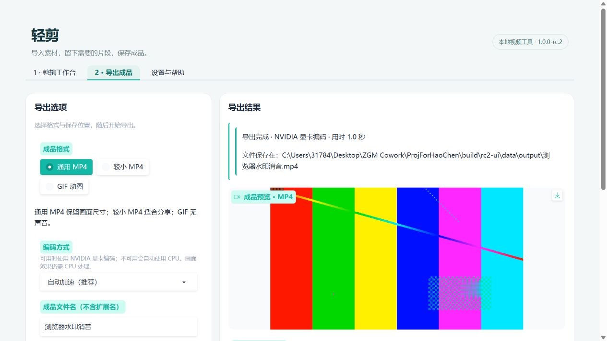
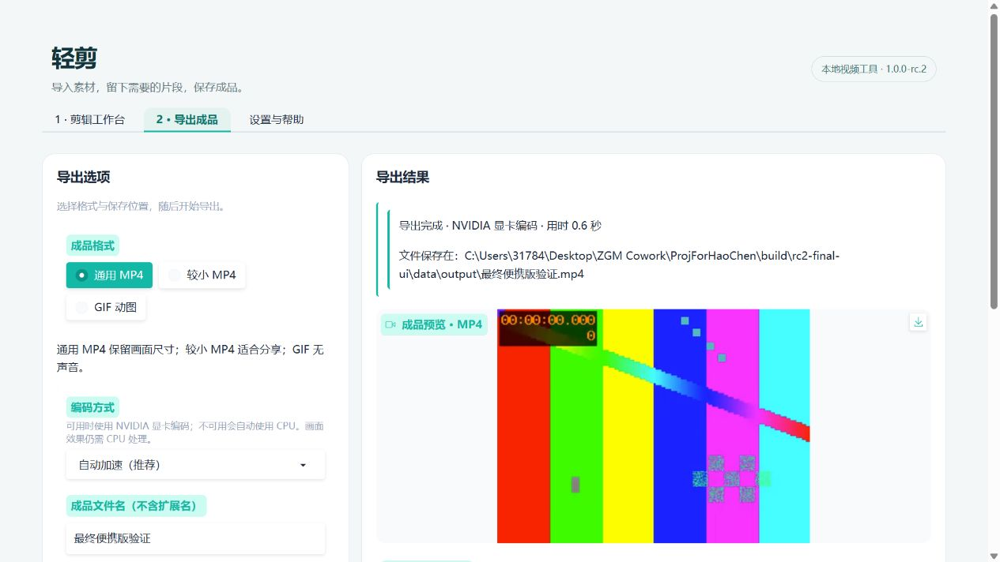

# rc.2 修订与验证

日期：2026-10-27。目标：`1.0.0-rc.2`。针对首位试用者的反馈修订；原机原素材复验仍待完成。

后续：用户提供实际 25 分钟 AV1 素材反馈，已在同机完成完整对照，最新结果见 [rc.3 记录](RC3_VALIDATION.md)。本页保留 rc.2 历史结果。

## 反馈与处理

试用环境由用户转述：Windows 11、AMD x64、RTX 4050 笔记本，已安装 Python、Git。约 20 分钟 1080p 视频，水印处理与消音，导出 MP4；约一分钟到 10% 后中止。另外反馈按钮布局缺少逻辑，并出现 `_ProactorBasePipeTransport._call_connection_lost` 的 WinError 10054。

- 增加真实 NVENC 试编码探测，可用时用 NVIDIA H.264 编码，失败整任务回退 CPU；取消时不重试。没有 GPU 的电脑继续使用随包 CPU 编码器。
- 选段在输入端准确定位并限制解码时长；多段合并复制已编码视频，避免第二次视频编码，音频重新对齐。单段旧版本来就没有二次视频编码，因此这项不应被描述为整段导出的提速原因。
- 工作台按导入、片段、声音、画面组织，导出与设置独立；默认隐藏空效果预览与高级参数，增加编码方式和耗时提示。
- 在实际服务循环上仅处理所报告的连接关闭回调与错误码，补齐 socket 关闭及 transport 分离；其他错误交回原处理器。它不是通用网络错误屏蔽器，原反馈缺少触发动作，不能据此断言所有 10054 场景都已复现。

## 同素材性能对照

本机 RTX 4060 Laptop GPU；生成 60 秒、1920×1080、30fps 的 testsrc2 视频，加水印区域淡化与消音。通过真实 rc.1 EXE 和 rc.2 API 提交导出计时，排除上传，包含任务调度、处理与成品准备；每种组合单次测量。输出均经过完整解码及尺寸、时长检查。脚本：`scripts/benchmark_rc2.py`，原始记录：`build/rc2-benchmark/report.json`。

复测时运行 `python scripts/benchmark_rc2.py --baseline "旧版完整解压目录/BiliVideoTool.exe" --hardware "本机硬件说明"`。每次在独立 `build/rc2-benchmark/run-*` 保存报告，避免重复运行读取到旧成品。

| 场景 | rc.1 CPU | rc.2 CPU | rc.2 NVIDIA |
| --- | ---: | ---: | ---: |
| 完整 60 秒 | 4.46 秒 | 4.32 秒 | 4.60 秒 |
| 截取末段 50–55 秒 | 1.40 秒 | 0.94 秒 | 未测 |

本次完整视频样例没有显示显著提速，NVIDIA 也未更快。后段截取耗时较少，与避免解码未选中部分的改动一致，但这不是统计基准。CPU 成品约 53.5 MB，NVIDIA 约 79.0 MB；两种编码器参数不等价，不能认为质量或体积相同。CPU 滤镜、解码、磁盘、驱动、电源模式与素材复杂度均可能影响总时间。

未获得原始 20 分钟素材，未在对方 RTX 4050 上测试，不承诺其导出耗时。用一分钟样例对照两种模式后，再完成原片复验。

## 自动与浏览器验证

新增回归覆盖准确后段首帧、0.5/1/2 倍速时长、20 个短片段合并后的时间戳与完整解码、显卡错误回退、取消不回退、真实显卡或 CPU 自动选择，以及真实 Windows 标准库关闭回调的资源清理。异常测试保留无关错误及原处理器。

实际浏览器已完成 1080p 上传、截取 5 秒、消音、画面提取、鼠标框选水印淡化、短效果预览、跨页导出与返回剪辑。导出提示确认使用 NVIDIA 编码，成功生成 MP4。

52 项 unittest 全部通过。最终 ZIP 在中文/空格目录解压、仅保留系统 PATH、从其他工作目录启动，通过随包媒体工具自检与 HTTP/API 流程；自动编码自检确认使用 NVENC，CPU 媒体流程同样通过。

验证覆盖：分割重排、撤销重做、裁剪/短预览/GIF、会话隔离、取消后继续导出、本地 HTTP 下载子进程及取消、中文目录设置与防覆盖、缓存保护、重复启动、端口占用回退、重启恢复设置，以及导出中退出后的清理。下载子进程的本地 HTTP 检查不等同于本版本的 B 站实网验收。

最终交付：`dist/bili-video-tool-1.0.0-rc.2-windows-x64.zip`，165,661,080 字节（约 165.7 MB）。SHA256：`f3c8b5ba892238913acfce7fdd300812e438905290c5d5f311c63f0a776776f5`。同目录有 `.sha256` 与 `-verification.json`。完整解压验证位于 `build/portable-中文 jw1lfaro/verification`，Windows 11 x64 开发机，不替代干净系统验收。

最终解压包另通过真实浏览器启动、素材上传与 NVIDIA MP4 导出，检查了未导入素材时的宽屏分栏；正常退出后实例记录与本次缓存均清理。下图为最终包实际页面，使用程序生成的一秒测试素材，耗时不能外推到真实长视频。

## 参考与边界

实现参考 [Python 3.12 事件循环异常处理 API](https://docs.python.org/3.12/library/asyncio-eventloop.html#error-handling-api) 和随包标准库的 Proactor 清理代码；编码器参考 [NVIDIA FFmpeg 指南](https://docs.nvidia.com/video-technologies/video-codec-sdk/13.0/ffmpeg-with-nvidia-gpu/index.html)，最终以随包 FFmpeg 的实际试编码为准。未更换全局事件循环策略，没有将需要 CPU 的画面滤镜宣称为 GPU 滤镜。

本版本仍是候选版；三人试用、干净环境复验和实际网站链接矩阵继续记录于 [用户试用表](USER_TRIALS.md)，不由开发机检查替代。尚未公开发布 GitHub Release。
