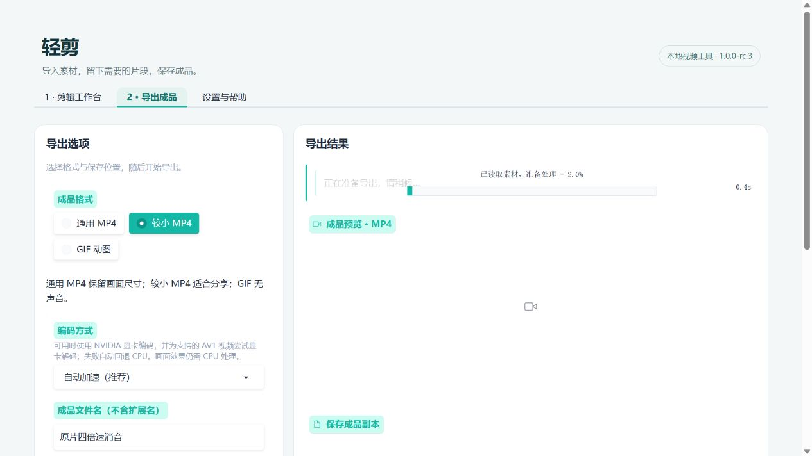

# rc.3：AV1 倍速导出修订

日期：2026-10-28。仍为发布候选，未替代三名新用户与干净系统验收。

## 复现信息

用户截图显示 rc.2 使用 NVIDIA 编码导出，耗时 609.6 秒；处理中有三个重复进度条和旧“已取消”提示。用户设置为约 25 分钟原片、4 倍速、消音、较小 MP4。摘要的 379.48 秒指成品播放长度。

只读检查本地素材得到：AV1、1920×1080、约 30fps、1517.916625 秒、yuv420p、有 AAC 音频。未移动或改写原片，也未修改用户正在使用的便携目录与设置。

## 修改与完整对照

- 先变速、筛选输出帧，再进行缩放、水印和裁剪；针对静态画面滤镜，减少在废弃帧上的处理。
- 自动模式为未旋转 8 位 4:2:0 AV1 尝试 av1_cuvid 解码；解码失败先回退 CPU 解码，NVENC 失败再回退 CPU 编码，取消不重试。
- 导出只绑定一处进度，并流式更新新任务状态；摘要改为“成品时长约”。

在同一开发电脑上顺序运行同一原片，保持 4 倍速、消音、1280×720、30fps 和相同 NVENC 参数，计时为处理管线（含探测、处理、合并，排除上传与浏览器准备）。每版单次整片测试：

| 流程 | 解码 | 编码 | 耗时 |
| --- | --- | --- | ---: |
| rc.2 原流程 | CPU | NVIDIA | 143.30 秒 |
| rc.3 | NVIDIA AV1 | NVIDIA | 45.52 秒 |

本次整片对照约快 3.1 倍、耗时减少约 68%。两次成品均为 379.466667 秒、1280×720、30fps；新成品完整解码通过。原始记录在 `build/rc3-probe/baseline_full.json` 与 `build/rc3-probe/optimized/report.json`，源码复测入口为 `scripts/benchmark_export.py`。

此前 609.6 秒未在本次旧流程复测中重现；不能将其全部归因于已修改环节，也不能声称优化后的每次耗时固定为 45 秒。后台负载、电源、驱动等当时状态没有足够证据确认。未上传原始视频或将其放进发行包。

## 验证

新增测试验证 AV1 的 4 倍速消音/保留声音、0.5 倍速、输出音画时长与完整解码；帧筛选提前前后的裁剪/水印/缩放结果逐帧哈希一致。另覆盖显卡解码/编码连续失败回退、取消不重试及未支持的旋转/10 位格式保留软件解码。

58 项回归已通过，其中新增流式导出跨执行上下文的取消与状态清理检查，防止生成器暂停期间持有任务上下文。构建时另执行便携版真实 AV1 解码自检及完整编辑 API 流程。

最终 ZIP 解压验证全部通过：随包 FFmpeg/ffprobe、AV1 自动解码/编码、CPU 媒体处理、编辑/预览/GIF、取消后继续导出、会话隔离、中文目录与同名避让、设置恢复、重复启动、端口回退和导出途中退出。验证仅用系统 PATH，从中文空格目录运行；本地 HTTP 下载测试不等同于 B 站实网复验。

独立源码页面再次导入原片，完成 4 倍速/消音/较小 MP4 的取消后重试，页面显示 **45.6 秒**完成、NVIDIA 解码 + 编码、成品 6 分 19 秒。过程中只出现一个进度条，新任务不再残留旧取消提示。正常退出后实例文件及本次缓存已清理，成品保留在 `build/rc3-ui/data/output`。本次浏览器检查与上述顺序管线对照单独记录。

交付：`dist/bili-video-tool-1.0.0-rc.3-windows-x64.zip`，165,661,859 字节（约 165.7 MB）。SHA256：`2a5bc114215d58c00ca6a51cb773fcaadbdeca2c778a3fb1713670ca19d62a6c`。同目录提供校验文件与验证报告；解压验证路径为 `build/portable-中文 yz6t2qg9`。旧版本 ZIP 保留。

