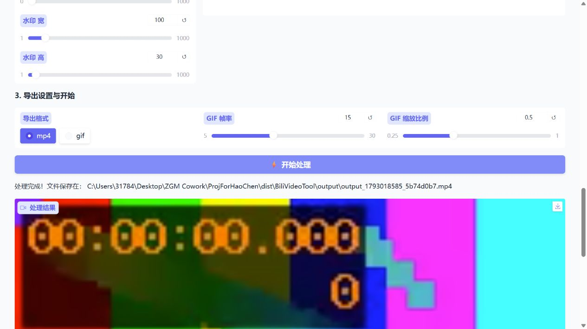

# A 阶段实现与验证记录

首次验证：2026-10-26；更新：2026-10-27  
版本：0.1.0-alpha.1  
结论：A 阶段开发与验收完成。自动回归、便携包构建与本机验证已通过；用户已确认 ZIP 解压后在线下载正常，并在未安装 Python/FFmpeg 的 Windows 电脑上成功启动、完成一次本地视频 MP4 导出。

## 已完成的实现

- Windows 安装、启动和构建脚本统一使用项目 `.venv`，检查错误并保留退出状态。
- 分享链接保留查询参数和片段标识；空视频、空片段等处理回调统一返回两个输出。
- 防止非有限数值导致表格转换崩溃；无效水印选区显示提示。
- 输出默认定位到源码目录或便携 EXE 所在目录，不依赖调用者的工作目录。
- 输出文件名增加随机后缀，避免同秒导出覆盖；失败时清理已经生成的部分片段；关闭 FFmpeg 管道并处理回调异常后的子进程退出。
- 锁定直接与传递依赖，分别提供运行和构建清单。
- GitHub Actions 工作流归位到仓库根目录，使用一致的测试、构建、解压自检脚本。
- 生成目录式便携 ZIP，内置 Python、FFmpeg、Gradio 静态资源和离线媒体自检入口。

## 关键问题复现

以原始提交 `09fd966` 中的函数为基线：

| 场景 | 原行为 | 修复后 |
| --- | --- | --- |
| `https://www.bilibili.com/video/BV1xx/?p=2&t=12#reply123` | 截断为视频路径，丢失查询参数 | 完整保留 URL |
| 未选择视频点击处理 | 返回三个输出，界面绑定两个 | 返回两个输出，页面显示“请先选择视频文件” |
| 渲染已创建部分文件后抛出异常 | 部分文件未进入清理列表 | 独立临时目录整体回收 |
| 同一秒重复导出 | 默认输出文件名相同 | 生成不同文件名 |

## 自动验证

运行环境：Windows 11 x64（10.0.26200）、Python 3.12.13。

主要锁定版本：Gradio 6.30.0、yt-dlp 2026.10.21、imageio-ffmpeg 0.6.0、Pillow 12.3.0、PyInstaller 6.22.3。FFmpeg 为 imageio-ffmpeg 随包提供的 Windows x64 v7.1。

- `python -m pip check`：通过，无损坏依赖。
- `python -m unittest discover -s tests -v`：17 项通过。
- 媒体使用 FFmpeg 生成，无需网络或用户私人视频。
- 覆盖 URL 参数、分享文字、错误回调、非法数值、界面构造、无声竖屏素材、变速、消音、裁剪、水印处理、多段拼接、GIF、无效素材、全部删除、失败清理和文件名避重。
- 第三方 Gradio 构造界面时会输出 asyncio 事件循环 ResourceWarning；测试退出成功，本次未修改第三方库。

## 发行包验证

文件：`dist/bili-video-tool-0.1.0-alpha.1-windows-x64.zip`  
大小：128,526,892 字节（约 128.5 MB）  
SHA256：`89e0a30ba12939ce7ee25006c3853723c6dac900a9f69538a349da3ab94a33ac`

构建脚本验证的是 ZIP 解压后的程序：

1. 解压到包含中文和空格的新目录。
2. 子进程 PATH 仅保留 Windows 系统目录，移除 Python/Conda 及外部 FFmpeg 相关环境设置，从其他工作目录启动。
3. EXE `--self-test` 生成样例并完成真实视频处理；确认是冻结程序、UTF-8 模式开启，FFmpeg 路径位于解压包内。
4. 成品为 120×100、30 fps、有音轨、1.53 秒（预期约 1.5 秒），并完整解码验证。
5. 启动打包后的本地服务，验证页面配置和本地 JS/CSS 资源可读取。
6. 通过 Gradio 客户端完成上传、读取片段、MP4 导出和结果下载；未选择视频时能得到正确提示。

机器可读结果位于 `dist/bili-video-tool-0.1.0-alpha.1-windows-x64-verification.json`；构建日志和样例位于 `build/`。这些生成文件不纳入源码提交。

## 浏览器人工流程检查

使用打包后的 EXE，在实际浏览器页面上验证：

- 下载页、处理导出页均可加载。
- 未上传素材点击处理，显示正确提示。
- 上传生成的 2 秒样例后可预览，读取信息得到 160×120 和整片片段。
- 点击处理后成功生成 MP4，页面显示输出路径、预览和下载入口。

## 在线下载检查

2026-10-26 开发环境检查：尝试 README 中已有的公开短链接 `https://b23.tv/7hLWYrn`，站点返回 HTTP 412（Precondition Failed），解析阶段即失败，该次检查未通过。结果保存在 `build/download-check/report.json`。该结果保留为特定环境与链接的历史记录。

2026-10-27 用户实测反馈：将本次生成的 ZIP 复制到本地电脑并解压，联网复制链接在线下载视频功能正常。在线下载基本流程据此记为用户实测通过；此项依据用户反馈，未由自动化重复验证。

用户尚未提供具体链接类型，因此不据此认定完整链接、短链、分享文字、带分 P 参数链接的全部组合均已通过。后续按发布验收清单补齐这些覆盖项。开发环境检查没有读取或导入用户登录 Cookie。

## 干净 Windows 环境用户验收

2026-10-27，用户明确确认以下验收项通过：在未安装 Python/FFmpeg 的 Windows 电脑上启动，并完成一次本地视频 MP4 导出。验收对象为本次生成并由用户复制、解压的便携 ZIP。

此项依据用户实测反馈记录，与开发环境自动化结果分别保留。至此，阶段 A 的干净环境启动、本地 MP4 导出及关键问题复现与验证要求均已满足，阶段 A 标记为完成。

## 验证边界与后续项

- 已完成本机“清理 PATH”的独立包检查，但本机本身安装了开发工具，不能将其等同于一台从未安装 Python/FFmpeg 的干净电脑。
- 干净环境启动与本地 MP4 导出已由用户确认通过。目标电脑的具体 Windows 版本、构建号与账户权限未记录，完整系统兼容性矩阵仍按后续发布验收推进，不影响本次 A 阶段结项。
- 工作流代码已就位，尚未推送到 GitHub，也未声称云端 Actions 已运行或 Release 已发布。
- 此早期便携包使用 imageio-ffmpeg 自带的 FFmpeg；独立 ffprobe/JSON 探测方案仍待后续落实。
- 可视化剪辑、会话状态隔离、统一进度/取消、GIF 专用预览、更新入口和完整兼容性矩阵按后续阶段推进。
