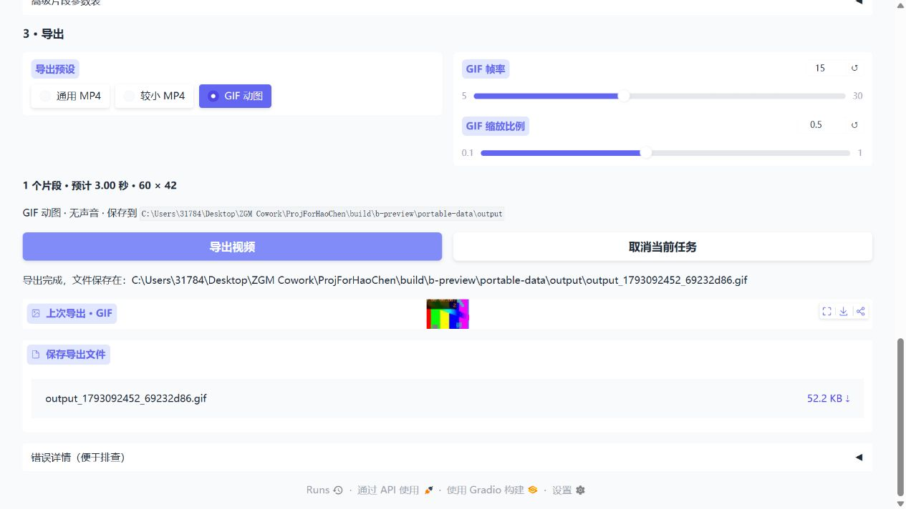

# B 阶段开发与验证记录

日期：2026-10-27  
版本：0.2.0-beta.1

结论：B 阶段开发与验收完成。28 项自动回归和解压后便携 EXE 的流程验证通过；用户进一步确认“全部验证通过”，剩余的新版 B 站实网下载及新用户操作体验验收据此记为通过。

## 交付包

文件：`dist/bili-video-tool-0.2.0-beta.1-windows-x64.zip`  
大小：128,552,097 字节（约 128.6 MB）  
SHA256：`e1dd286e2d4253bbdd1a10192732eed704df323e7fb5c0896fbcfcbe5264a51a`

原 A 阶段 `0.1.0-alpha.1` ZIP 保留。新包仍为目录式便携版，解压完整目录后运行 `BiliVideoTool.exe`。

## 交付内容

- 同页完成导入、编辑与导出。本地上传或下载完成后自动载入信息、视频预览和整片片段。
- 每个页面独立保存素材、选中片段和编辑历史，移除共享下载路径和固定水印图片缓存。
- 播放位置选点、修改起止时间、分割替换原片段、上移/下移、删除、重置、撤销/重做。
- 消音与倍速支持当前或全部片段；高级参数表仍可编辑，点击应用后生效。
- 鼠标或触屏拖动画面矩形，应用裁剪或水印淡化；以归一化坐标换算缩放，并匹配视频旋转后的尺寸。
- 当前片段开头最多 5 秒效果预览；通用 MP4、较小 MP4、GIF 三种预设；显示预计时长、尺寸和目录。
- GIF 使用图片组件预览，MP4 使用视频组件；结果提供文件下载入口。
- 每次只运行一个重型任务；各页面可取消自己的排队或运行任务。取消下载时终止下载子进程及合并进程；取消导出时终止 FFmpeg、清理中间文件和半成品，随后可继续下一任务。
- 片段校验与排序分离，严格按编辑顺序导出；整体处理进度不随片段切换回退。

## 验证方法

自动测试使用生成的样例，不依赖私人素材或在线站点。除 A 阶段回归外，增加分割继承效果、重排与历史、会话隔离、过期选区拒绝、缩放坐标、真实红蓝片段顺序、旋转元数据、取消子进程、取消后清理与再次导出的覆盖。

`scripts/check_editor_api.py` 从实际 Gradio 会话接口执行导入、分割、重排、撤销重做、消音变速、框选、短预览、GIF 导出、双会话隔离、取消后 MP4 导出。还通过本地 HTTP 提供生成视频，验证真实 yt-dlp 下载子进程及下载取消。

`scripts/build_portable.py` 在测试和打包后，解压候选 ZIP，在仅含系统目录的 PATH 下执行离线自检及上述会话流程；通过后才输出最终 ZIP、校验值和验证 JSON。

浏览器人工流程已验证：上传自动载入、修改终点并消音、GIF 导出与图片预览、鼠标拖出矩形并应用裁剪、播放定位分割及短预览。

## 验证结果

- `python -m unittest discover -s tests -v`：28 项通过。Gradio 构造界面时仍有第三方 asyncio ResourceWarning，测试正常结束。
- ZIP 解压后自检：通过，使用包内 Python 3.12.13、FFmpeg 7.1，UTF-8 模式开启。
- 环境隔离：中文/空格路径、其他工作目录、PATH 仅含系统目录。沿用已锁定依赖，本次未升级第三方包。
- 实际 EXE 会话检查：自动载入、分割/重排/历史、框选/短预览/GIF、双会话隔离、取消导出后再次导出均通过。
- 下载子进程：本地 HTTP 真实下载并自动载入通过；网络等待期间取消下载、清理后继续导出通过。
- 实际 EXE 浏览器检查：上传 8 秒生成样例，剪短到 3 秒、消音、鼠标框选裁剪并导出 GIF，页面显示正确结果及文件入口。
- 构建检查发现并修复同一取消函数绑定两个按钮时的接口命名冲突；新增接口名称检查，最终包重新构建并通过完整验证。

机器可读报告：`dist/bili-video-tool-0.2.0-beta.1-windows-x64-verification.json`。构建日志与生成样例保存在 `build/`，不纳入源码提交。

## 使用边界

- 本版本新增下载任务封装通过本地 HTTP 样例验证；新版 B 站实网下载已由用户确认通过。此项依据用户反馈记录，与开发环境自动化结果分别保留。
- 编辑历史位于当前页面会话，刷新会重置；持久化编辑方案属于后续阶段。
- 短预览成功文件保存在 `cache`，自动缓存管理与配置持久化按 C 阶段推进。
- Windows 下载取消使用系统 `taskkill /T` 终止当前任务进程树；本次不宣称 macOS/Linux 便携包兼容性已验收。
- 完整 ffprobe JSON 探测、更多媒体兼容性和正式发布检查仍按项目规划推进。
- 阶段 B 的新用户操作体验验收已随用户的“全部验证通过”反馈记为通过；本次未记录具体参与人数，C 阶段的至少三名新用户试用要求仍按后续计划执行。

## 2026-10-27 用户验收

用户在收到 `0.2.0-beta.1` 便携包及剩余验收说明后，明确反馈“全部验证通过”。结合此前的自动回归、便携包流程验证和浏览器检查，B 阶段标记为开发与验收完成，下一阶段为 C：v1.0 发布候选准备。
