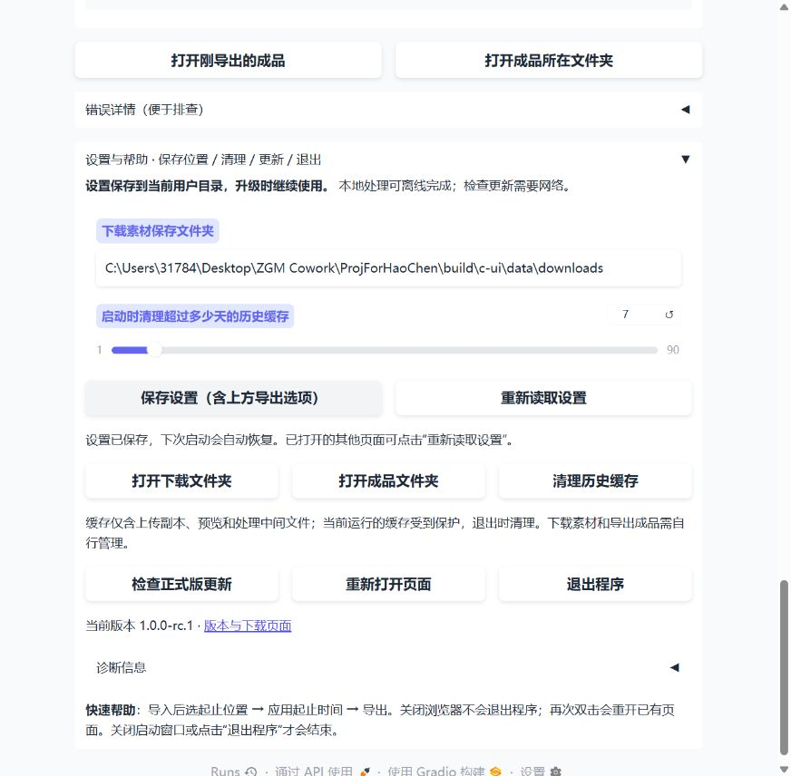

# C 阶段验证记录

初始记录：2026-10-27；收尾更新：2026-10-28。当前验收版本：`1.0.0-rc.4`。

**当前状态：C 阶段开发与约定范围用户验收完成。** rc.4 的 67 项回归、最终 ZIP 验证及原片测试通过，用户自行导出截图为 37.3 秒，并确认两台不同电脑均达到理想效果。用户没有三名独立测试者，现按其实际资源接受两台电脑的实测作为本阶段验收依据，扩大试用范围作为后续建议，不再作为收尾门槛。见 [rc.4 验证](RC4_VALIDATION.md) 和 [用户实测记录](USER_TRIALS.md)。

以下实现及自动检查数据保留 rc.1 的历史结果，不作为最新测试数量。公开发布尚未进行；未提供的机器配置和未覆盖场景保持未知，不影响本阶段按调整后的范围完成验收。

## 本次实现

- 配置原子保存、损坏备份恢复；记住下载/成品目录、导出预设、GIF 参数、缓存保留天数。
- 自定义成品名称、独占创建防覆盖、打开成品及文件夹；目录不可写和空间不足时明确提示。
- 程序资源与用户配置/日志/缓存分离；程序目录不可写时使用用户目录保存文件。
- 每次运行独立缓存，当前运行受保护，正常退出时清理；历史清理不跟随目录链接，不删除下载和成品。
- 用户配置级实例锁、重复启动重开、端口占用自动选择、页面重开、取消任务后退出。
- 滚动日志和可复制诊断信息，隐藏链接和常见登录凭据；正式版本检查只读、不自动安装。
- 固定校验 ffprobe 8.1.2 随包分发，JSON 媒体信息读取；MIT 项目许可证及第三方许可来源。

## 自动验证

43 项 unittest 通过，包含 A/B 既有流程与新增配置、缓存、文件保护、实例锁、更新异常、日志隐藏、媒体矩阵，以及保存位置摘要实时跟随输入。

媒体由程序生成，不使用私人视频。新增覆盖：161×121 奇数尺寸转偶数、可变帧率、0.5/1/2 倍速的音视频起点和时长、损坏文件、纯音频拒绝。音画同步验证基于生成样例的时间戳与时长，不能替代长视频的人工听看检查。

磁盘不足、目录权限和更新接口的多种响应使用受控替身复现；不将其描述为真实磁盘耗尽或每种网络状态的实测。ffprobe、转码、播放解码、中文路径和文件避重使用真实程序/文件。

实网执行过一次更新检查，GitHub 返回限流，界面正确提示稍后再试。无更新/有更新/离线/未发布的分支由自动测试覆盖；没有声称已成功查询到正式版本。

## 最终 ZIP 验证

最终交付：`dist/bili-video-tool-1.0.0-rc.1-windows-x64.zip`，165,648,386 字节（约 165.6 MB）。

SHA256：`9f05defdfcabb831c1d1f5d4ffcf3e289bae63fbcf55f39414e771b11e5ac0bb`。

同目录提供 `.sha256` 和 `-verification.json`。检查对象为 ZIP 解压产物，位于中文/空格路径 `build/portable-中文 qt7ww2k8`，从其他工作目录运行，PATH 仅保留系统目录。运行环境为 Windows 11、10.0.26200、x64；这是一台开发电脑，不能替代独立干净系统验收。

- 自带 Python 3.12.13、FFmpeg 7.1、ffprobe 8.1.2；报告确认两个媒体工具均来自解压包内部。
- 113 个界面组件、2 个本地页面静态资源检查通过；媒体自检完成分段、消音、变速、裁剪、水印、MP4 导出及完整解码。
- 自动载入、分割重排、撤销/重做、框选、短预览、GIF、会话隔离、取消后再导出通过。
- 真实下载子进程用本地 HTTP 样例完成下载和取消恢复验证；未将其等同于 B 站实网兼容性验收。
- 自定义中文下载/成品目录、同名避让、无效名称提示、清缓存后继续导出、诊断信息通过。
- 端口已占用时启动、重复启动复用、重启后恢复设置、正常退出与缓存清理通过；重启验证还在 80 段导出进行时退出，确认取消提示及无残留半成品。

实际浏览器中再次上传样例、修改中文保存目录和文件名、确认摘要立即更新、导出 MP4、保存设置并正常退出。测试实例已关闭，当前运行缓存已清理，成品保留。

## 后续可扩大的验证覆盖

- 本候选 ZIP 在未安装 Python、FFmpeg、Git 的 Windows 普通账户下解压、双击、离线编辑并导出；记录 Windows 版本及 x64 架构。
- B 站完整链接、短链、分享文字及带分 P 参数链接的真实下载；登录受限/网络失败提示。
- 有条件时邀请更多未参与开发的人独立完成导入、剪出一段、导出并找到成品；使用 [试用记录表](USER_TRIALS.md)，不设固定人数作为本阶段完成条件。
- 真实手机和较长视频的画面、声音、同步及操作体验；修复试用发现的阻断问题后再定正式版本。

上述未覆盖项作为后续兼容性验证建议保留，未记为已通过。C 阶段的当前范围验收已根据用户两台电脑的实际反馈完成，公开 GitHub Release 另行安排。
